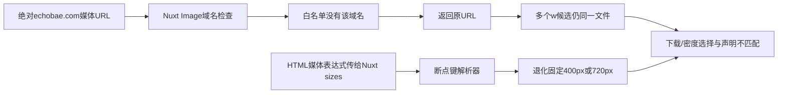

# 图片实施与上传规范

所有文件物理像素/体积是2026-10-14独立GET/Pillow解码；渲染尺寸/fit/priority来自2026-10-13 DOM。不是今天新浏览器截图，也不保证今天已启用同一布局。完整URL/属性见IMAGE_SAMPLES.csv。

## 代表图实测

|类型|物理尺寸|文件体积 KiB|历史渲染尺寸 CSS px|fit|几何裁剪|
|---|---|---:|---|---|---:|
|首页Banner|1672×941|29.6|1304.0×733.9|contain|0.0%|
|首页Banner第二张|1672×941|87.4|1304.0×733.9|contain|0.0%|
|首页分类入口|437×633|56.0|466.7×676.7|cover|0.1%|
|分类商品卡片|600×900|75.3|260.4×260.4|cover|33.3%|
|商品主图|600×900|40.1|714.0×892.5|cover|16.7%|
|商品缩略图-大文件|1707×2560|115.4|68.0×68.0|cover|33.3%|
|商品详情图|2560×1707|249.8|1392.0×928.2|fill|0.0%|
|商品详情说明图|1600×630|118.3|1392.0×548.1|fill|0.0%|
|博客封面|1254×1254|140.5|448.0×280.0|cover|37.5%|
|移动Banner|1672×941|29.6|390.0×219.5|contain|0.0%|
|博客材料对比封面|1254×1254|110.3|448.0×280.0|cover|37.5%|

“裁剪百分比”是尺寸与cover推导的几何面积损失，**不是已经量出被切掉多少身体细节**。图片中主体位置不同，需运营按构图确认。

## 建议上传尺寸、比例及文件预算（目标，不是实测性能承诺）

|图片用途|推荐原始上传/候选|比例/构图|建议WebP/AVIF目标范围|修改责任与条件|
|---|---|---|---|---|
|桌面首页Banner|1600×900或1920×1080；候选640/960/1440/1920宽|当前约16:9，文字安全区独立留出|40–150KB一般预算；**现有首图30KB已无需为达预算重压**|运营提供合适构图；开发width/height/ratio、current首图high、其他轮播延后|
|移动Banner|640×360或960×540；若采用独立竖构图再设相应舞台|保留16:9可不增加移动高度；文字必要时放图下。不要直接把桌面照片强裁竖图|30–100KB|开发picture/source断点；设计比较文本可读性与CTA位置，不机械要求新图|
|分类商品卡片|完整原图建议1200×1800；交付候选400/800/1200宽|统一2:3照片；舞台可保留方形但contain/统一背景，或专用完整主体方图|单卡40–120KB候选；精细照片按质量验收|运营上传真实SKU和焦点；开发provider/sizes、容器布局。方图不是都必须变竖卡|
|产品主图/放大|建议1600×2400原图；480/720/960/1440宽实际候选|现600×900在约714CSS宽+DPR2下不足；主舞台4:5 contain或2:3固定比例|展示候选80–250KB；放大原图可150–500KB按需加载|开发保证真实候选，原图不为追求小KB过度压缩|
|产品缩略图|从原图生成144/192/240宽候选|舞台68–96CSS px；允许聚焦缩略但主图/Zoom必须完整|5–20KB每张|现某缩略下载1707×2560/118KB，优先做实际小候选；不要让所有缩略下载原图|
|商品详情照片/拼图|展示1280–1600宽，原图按信息密度保留|height:auto保留原始横/竖比例；图中规格需HTML文本可读|100–300KB，复杂拼图可更高但按实际传输决定|现255810B大拼图不误裁，关键是手机文字/规格可读与Alt；不能一刀切cover|
|博客列表封面|1200×750或1280×800，480/800/1200候选|当前舞台约8:5，1254方图被裁37.5%；上传适合该舞台的构图|50–150KB|运营独立封面，开发不要把正方原图任意裁掉主体。示意图/标题有安全区|
|博客正文配图|按正文最大宽约760CSS px提供960/1520宽|遵循图片自身比例，height:auto|80–250KB按内容复杂度|TPE对比样本正文未发现img，**不为SEO硬加图**；有帮助的材料示意才加入且事实核对|
|Logo/小图标|有真实矢量源用SVG，否则约2×CSS像素PNG/WebP|contain，明确固有尺寸|Logo一般5–30KB；图标更小|当前209×40用于160CSS宽可在高DPR清晰度不足；换源需视觉核对，非首要故障|

预算是初始验收目标；图片内容复杂度、压缩质量和真实移动设备视觉优先，不能保证具体提升百分比。原图应在媒体系统保留，不用压缩后的文件作为以后唯一母版。

## 保持视觉协调同时避免误裁

**首选小改方案**：继续保留已有方形商品卡片和4:5主舞台，给全身主照片contain与一致中性背景。卡片高/列表密度不变，照片有侧边留白但头身完整。半身/细节照片可专用焦点crop；不把全部图片都contain或全部都cover。

**改舞台方案**：主要商品图统一2:3，使原始竖照无损显示，但手机主图比现4:5更高，价格/CTA会下移；应配合缩略图、购买操作和屏内信息重新验收。

**运营构图方案**：保持方图，上传实际包含完整主体的方形工作图，而非让CSS从2:3原图自动截中段；保持所有SKU背景/主体规模一致。原图母版/详情放大仍保留。

固定cover的object-position可以移动保留区域，**无法恢复容器放不下的完整身体**；不把移动焦点当作通用无裁剪方案。

## 候选生成已定位的问题链

解决办法和建议代码见TECHNICAL_PATCH_GUIDE.md。服务端IPX alias内部origin不是给浏览器访问的URL，不能盲删合法取图配置；也不能从浏览器请求内部host。

## 需要修正的Alt与信息承载

Lydia详情图片“Your paragraph text.webp”展示身体尺寸/结构细节；“Untitled design.webp”展示面部、手部和摆姿拼图。建议分别使用：

- `Silicone doll body sizes and construction details`
- `Close-up views of doll faces, hands and posing`

这些是看过原图后的修改建议，运营仍需确认图片是否泛品牌示例而非当前SKU配置；图中各型号尺寸不要误说为Lydia的规格。当前商品本身高度/围度等应在HTML规格表准确展示。不要把Alt写成关键词列表或强塞优惠文案。

## 图片复检

1. HTTP下载各候选，用实际文件解码核对像素，而非只读naturalWidth；srcset密度可以让naturalWidth归一化。
2. 390/412/768/1440视口及DPR1/2检查currentSrc、清晰度、舞台/实际对象边界、加载优先级。
3. 首图/轮播/缩略/详情/博客分别检查；自动懒加载未触发不等于坏图。
4. 加载前就保留ratio/width/height。当前新增adaptive若onload才从1:1变原图比例，仍可能移位，必须复测而不是认定已修。
5. 不出现私有HTTP URL、图片404、错误fallback，关键图Alt和可读规格一致；当前新浏览器验收未执行。
